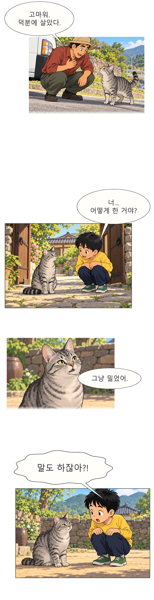

# toon_lab

[English](README.md) · [한국어](README.ko.md) · [日本語](README.ja.md)

画像生成AIとPythonで縦スクロールのウェブトゥーンを制作するツールです。エージェントに接続された画像生成ツール（GPT系の画像生成ツールなど）でコマの原画を作り、ローカルのPythonコードで韓国語の文字入れ、吹き出し、コマ配置、縦長PNGの組み立てを行います。

ローカルGPUは不要です。このリポジトリのPythonコード自体が画像生成モデルを実行するわけではありません。エージェントには画像の生成・閲覧、ローカルファイルの保存、コマンド実行の機能が必要です。

> **違法利用の禁止：** このリポジトリのスキル・コード・制作手順を、いかなる違法行為や他者の権利を侵害する行為にも使用しないでください。使用前に[利用指針と禁止事項](#利用指針と禁止事項)を確認してください。

## 最初のウェブトゥーンを作る

Git、Python 3.11以上と、画像生成・閲覧、ローカルファイル操作、コマンド実行が可能なAIエージェントを用意してください。

### 1. リポジトリを取得する

```sh
git clone https://github.com/DoHyunBak/toon-lab.git
cd toon-lab
```

### 2. AIエージェントでフォルダーを開く

取得した `toon-lab` を作業フォルダーとして開き、次のように依頼してください。

```text
このフォルダーのAGENTS.mdを読み、接続された画像生成ツールでサンプルのコマを1枚作ってください。
原画には文字を描かず、後からPythonで韓国語の文字入れをしてください。
完成したPNGのパスも教えてください。
```

自分の物語を使う場合は原稿を貼り付けるか、ファイルパスを伝えてください。アイデアから始める場合の例です。

```text
雨の日に野良猫が傘の下に入る短い物語を、縦スクロールの4コマにしてください。
まず1コマで画風を確認し、残りのコマを作って韓国語の台詞を入れてください。
```

エージェントがPython環境とPretendardを準備し、原画に韓国語の吹き出しを重ねて組み立てます。接続済みの画像ツールを使う場合、追加のAPIキーは不要です。

### 3. 結果を開く

作業ファイルと結果は `workspace/local/` 以下に保存します。エージェントが案内する作業フォルダーで、次のファイルを開いてください。

- **`full_strip.png`**：1話全体をまとめた縦長画像。
- **`slice_001.png` 以降**：分割した縦長画像。
- **`read.html`**：開示文を含むレビュー用パッケージを作成した場合のブラウザープレビュー。

画像生成ツールがない場合でも、下記のオフラインデモで文字入れと組み立てを試せます。詳細なコマンドは[エージェント画像制作手順](docs/public/AGENT_IMAGE_WORKFLOW.md)を参照してください。リンク先の運用文書は主に韓国語です。READMEは上記の3言語で提供しています。

## 制作例

**《임자의 모험》（イムジャの冒険）第1話より抜粋 · toon_lab制作チーム · AI生成原画と韓国語の文字入れ**

完成作から4コマを抜粋しました。コマごとのサイズと余白を調整し、表情を隠さないように吹き出しを配置した例です。

独自の原稿と絵コンテを基に制作しました。他のウェブトゥーンのコマやキャラクターデザインを複製・トレースせず、他作品の画像を生成モデルへ入力していません。適切な利用根拠のある資料を使い、ツールとフォントの利用条件を守る方針です。[制作と著作権の確認手順](docs/public/COPYRIGHT_SAFETY.md)

構図の検討が必要な場面では、人物の位置や視線を簡単な線で整理しました。掲載例の原画は、場面と構図を文章で説明したプロンプトのみを使い、複数回生成しました。結果を比較してコマを選び、韓国語の文字入れ、吹き出し、コマの大きさ、余白を調整しました。



[サンプルPNGを原寸で開く](docs/public/examples/webtoon-preview.png)

## オフラインデモを実行する

Windows PowerShellでは、取得したフォルダーから実行します。

```powershell
py -3 -m venv .venv
.\.venv\Scripts\python.exe -m pip install -r requirements.txt
.\.venv\Scripts\python.exe tools/setup_open_fonts.py
.\.venv\Scripts\python.exe -m src.demo
```

macOSとLinuxでは次を実行します。

```sh
python3 -m venv .venv
.venv/bin/python -m pip install -r requirements.txt
.venv/bin/python tools/setup_open_fonts.py
.venv/bin/python -m src.demo
```

フォント準備ツールは公式PretendardファイルとOFL通知を取得し、ハッシュを確認します。終了後に `workspace/06_output_webtoon/demo/full_strip.png` を開いてください。デモはサンプル原稿と合成された仮画像を使用します。

Pythonやフォントの準備状況は、仮想環境のPythonで `-m src.factory doctor` を実行して確認できます。[フォント案内](docs/public/FONTS.md)と[トラブルシューティング](docs/public/TROUBLESHOOTING.md)も参照してください。

## 制作の流れ

1. 原稿を場面ごとのテキスト指示に整理し、入力資料の利用権限を確認します。
2. 接続された画像生成AIで文字のない原画を作り、実際の結果を確認します。
3. 原画を登録し、PythonとPillowで韓国語の台詞・吹き出し・効果音を入れ、コマのサイズと余白を調整します。
4. 縦長PNGを組み立て、モバイル幅で流れと読みやすさを確認します。

[制作運用手順](docs/public/PRODUCTION_RUNBOOK.md)と[文字入れ・編集ガイド](docs/public/EDITORIAL_LETTERING_PLAYBOOK.md)に詳細があります。

## 使用ツールとコードの出典

### 基本ツール

- **画像生成AIツール**：GPT系の画像生成ツールなど、エージェントで使用可能なツールで原画を作ります。画像の生成と結果ファイルの保存が必要です。サービスのアカウントやプロバイダーのAPI接続はこのリポジトリに含まれません。
- **Python・[Pillow](https://github.com/python-pillow/Pillow)**：原稿と画像の処理、吹き出しと韓国語の文字入れ、縦長画像の組み立てに使います。依存パッケージは [requirements.txt](requirements.txt) にあります。[Pillowライセンス](https://pillow.readthedocs.io/en/stable/about.html#license)
- **[Pretendard](https://github.com/orioncactus/pretendard)**：韓国語の文字入れに使うSIL OFLフォントです。標準はMedium（500）、強調はBold（700）です。[原ライセンス](https://github.com/orioncactus/pretendard/blob/v1.3.9/LICENSE) · [フォントの準備と方針](docs/public/FONTS.md)

実行手順は[エージェント画像制作手順](docs/public/AGENT_IMAGE_WORKFLOW.md)に従ってください。

### 改変・参考にしたコード

**原プロジェクト：[ahmet360/manga-studio](https://github.com/ahmet360/manga-studio) · 著作権者：ahmet360 · ライセンス：MIT**

**使用コミット：[`2ac3cf4e3d1aaec7dd39ff44498e4e8a186733c4`](https://github.com/ahmet360/manga-studio/tree/2ac3cf4e3d1aaec7dd39ff44498e4e8a186733c4)**

| 本プロジェクトのファイル | 原コード・参考元 | 改変・参考の範囲 |
| :--- | :--- | :--- |
| [src/bubble_renderer.py](src/bubble_renderer.py) | [manga-studio / bubbles.py](https://github.com/ahmet360/manga-studio/blob/2ac3cf4e3d1aaec7dd39ff44498e4e8a186733c4/bubbles.py) | 吹き出しと尻尾の幾何計算、文字計測と折り返しを基に、韓国語の文字入れと衝突検査へ対応。 |
| [src/webtoon_stitcher.py](src/webtoon_stitcher.py) | [manga-studio / assemble_pages.py](https://github.com/ahmet360/manga-studio/blob/2ac3cf4e3d1aaec7dd39ff44498e4e8a186733c4/assemble_pages.py) | Pillowのキャンバス・貼り付け・保存処理を、縦横比を維持した縦長配置と分割に変更。 |
| [src/script_formatter.py](src/script_formatter.py) | [manga-studio](https://github.com/ahmet360/manga-studio/tree/2ac3cf4e3d1aaec7dd39ff44498e4e8a186733c4) | パーサー構造と文法を参考に、TXT/JSONアダプターを別途実装。 |

**原著作権・MIT通知の全文と詳細な変更範囲は [THIRD_PARTY_NOTICES.md](THIRD_PARTY_NOTICES.md) に保存しています。** 出典表記はコードの由来を説明するものであり、制作時にmanga-studioを別途実行する必要はありません。

### 任意のレビュー連携

**TypeSafe/Jevのレビュー連携コード**も含まれています。基本の画像生成・文字入れ・組み立てには不要です。この経路を選ぶ場合に、環境と接続を別途準備してください。[レビュー連携の範囲](docs/public/LEGAL_QA.md)

### 制作方式の調査資料

他の制作リポジトリや創作・編集資料の調査は、[作家・演出ワークフロー](docs/public/AUTHORING_WORKFLOW.md)と[文字入れ・編集ガイド](docs/public/EDITORIAL_LETTERING_PLAYBOOK.md)に整理しています。企画と編集判断の参考資料であり、インストールが必要な依存ツールの一覧ではありません。

## 公開範囲

公開版には制作コード、文書、テスト、汎用JSON例と上記の抜粋画像1枚が含まれます。ソフトウェアのMITライセンスは抜粋画像には適用されません。作業原稿、他の原画、制作記録、モデルの重み、フォント本体、認証情報は利用者のローカル作業領域で管理してください。管理者が制御するローカル環境で使用し、ローカルのファイル処理機能をインターネットへ直接公開しないでください。

- [ソース公開手順](docs/public/RELEASING.md)
- [セキュリティ方針・脆弱性の報告](SECURITY.md)
- [MITライセンス](LICENSE)と[第三者通知](THIRD_PARTY_NOTICES.md)
- [ライセンス適用範囲](docs/public/LICENSE_SCOPE.md)

## 利用指針と禁止事項

**このリポジトリのすべてのスキル・コード・例・制作手順は、適法かつ正当な権限のある作業にのみ使用してください。違法行為の実行、他者の違法行為の支援、その実行方法の提供に使用することを禁止します。** テスト・研究・教育目的と説明するだけで禁止行為が許されるものではありません。

次の用途には使用しないでください。以下に記載がなくても、違法行為や権利侵害への利用は禁止します。

- **著作権・ライセンスの侵害**：必要な許諾や適法な根拠なく原稿・漫画・画像・フォント・モデル等を複製・入力・改変・配布する行為、必須の著作者表示やライセンス通知を除去する行為。
- **詐欺・なりすまし・欺瞞**：人物や組織へのなりすまし、証拠・制作履歴・承認記録の捏造によって他者を欺き、または財産上の被害を与える行為。
- **性的搾取と非同意の性的画像**：児童の性的虐待・搾取を描く資料の制作・所持・配布、本人の同意のない性的画像・合成物・ディープフェイクの制作・配布。
- **プライバシー・人格権の侵害**：適法な根拠なく個人情報・私生活の情報・非公開資料を収集・公開・外部送信する行為、ストーキング・脅迫・嫌がらせ・名誉毀損への利用。
- **無断アクセス・保護措置の不正な回避**：許可されていないアカウント・システム・資料へのアクセス、認証情報の窃取、アクセス制御・有料利用制限・安全措置の不正な回避。
- **その他の犯罪・違法な流通**：犯罪の計画・助長・支援、違法な制作物の販売・配布・拡散。

利用者は適用法令、入力資料の権利・ライセンス、接続するAIサービスと公開先プラットフォームの利用条件を確認し、遵守してください。実際の入力資料と生成・編集・公開行為の適法性を確認する必要があります。リポジトリの公開、AI生成結果、自動検査の通過は、他者の資料を使う権利や作品の適法性を保証しません。

**エージェントは上記の禁止行為に該当する依頼を実行してはいけません。** 入力資料の権限や外部送信の許容範囲が不明確な場合は、該当作業を保留して必要な根拠を確認してください。実行記録・検査結果・同意・承認を捏造して制限を回避してはいけません。

本項はプロジェクトの利用・運用指針です。ソフトウェアの配布ライセンスは既存の [MITライセンス](LICENSE) を維持し、第三者の資料と外部サービスにはそれぞれの権利と条件が適用されます。

### 指針の作成に参考にした公開スキル開発者の原文

権限のある範囲への利用制限、不正利用の禁止、外部送信への同意、利用者責任の示し方を参考にしました。上記の禁止項目はウェブトゥーン・画像制作向けに別途記述しています。各開発者が本プロジェクトを審査・保証したことを意味しません。

- **Agent Skills Hub**：[Security Guardrails & Policy](https://github.com/agent-skills-hub/agent-skills-hub/blob/main/docs/SECURITY_GUARDRAILS.md) — 許可された用途、不正利用の禁止、外部送信への同意、利用者責任の記載方法。
- **UnitOneAI / SecuritySkills**：[AI Data Privacy & Governance Review — Safety Notice](https://github.com/UnitOneAI/SecuritySkills/blob/main/skills/ai-security/ai-data-privacy/SKILL.md) — 権限のある対象に限った作業と、無断利用の禁止の記載方法。

## 問題の報告と対応方針

出典の記載漏れ、ライセンス違反、著作権侵害、その他の問題があると判断された場合は、[このリポジトリのGitHub Issues](https://github.com/DoHyunBak/toon-lab/issues)からご連絡ください。該当ファイル・内容、原典、問題と考える根拠をお知らせください。脆弱性や非公開資料を含む報告は、[セキュリティ報告の案内](SECURITY.md)に従ってください。

**問題が確認された場合は、直ちに該当内容の公開・配布を停止し、出典の補足・修正・削除など必要な対応を行います。解決が困難な場合、またはリポジトリの維持が適切でない場合には、直ちにリポジトリを廃止・削除します。**
