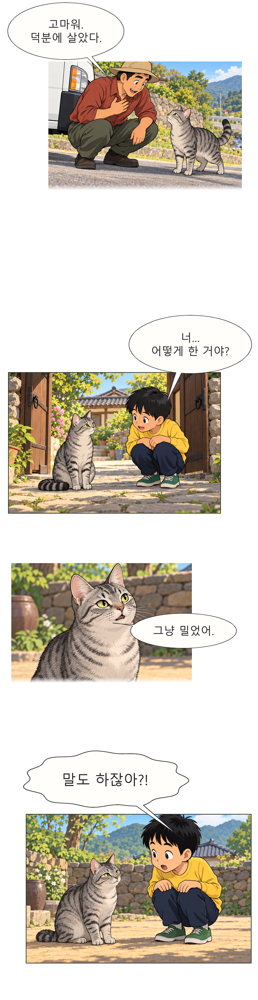

# toon_lab

[English](README.md) · [한국어](README.ko.md) · [日本語](README.ja.md)

이미지를 생성할 수 있는 생성형 AI와 Python으로 세로 스크롤 웹툰을 만드는 제작 도구입니다. GPT 계열의 이미지 생성 도구 등으로 컷 원화를 만들고, 로컬 Python 코드로 한글 식자·말풍선 배치·세로 PNG 조립을 처리합니다. 이미지 생성·보기와 로컬 파일 저장·명령 실행이 가능한 AI 에이전트가 이 과정을 진행합니다.

별도 로컬 GPU는 필요하지 않습니다. 이미지 생성은 에이전트에 연결된 도구가 담당하며, 이 저장소의 Python 코드가 자체적으로 이미지 생성 모델을 실행하는 것은 아닙니다.

> **불법 이용 금지:** 이 저장소의 스킬·코드·제작 절차를 어떠한 불법 행위나 타인의 권리를 침해하는 행위에도 사용하지 마세요. 사용 전 아래 [이용 지침 및 금지 행위](#이용-지침-및-금지-행위)를 확인해 주세요.

## 첫 웹툰 만들기

**준비물**은 Git, Python 3.11 이상, 이미지 생성·보기와 로컬 파일 저장·명령 실행이 가능한 AI 에이전트입니다.

### 1. 저장소 받기

```sh
git clone https://github.com/DoHyunBak/toon-lab.git
cd toon-lab
```

### 2. AI 에이전트에서 폴더 열기

방금 받은 `toon-lab` 폴더를 에이전트의 작업 폴더로 열고 아래 요청을 복사해 보세요.

```text
이 폴더의 AGENTS.md를 읽고, 네 이미지 생성 도구로 샘플 웹툰 한 컷을 만들어줘.
그림에 글자를 그리지 말고 나중에 한글로 식자해줘. 완성 PNG 경로도 알려줘.
```

내 이야기로 만들려면 원고를 채팅에 붙이거나 파일 경로를 알려주세요. 아이디어로 시작할 때는 아래 예시처럼 소재와 컷 수를 적으면 됩니다.

```text
비 오는 날, 길고양이가 우산 아래로 들어오는 짧은 이야기를 4컷 세로 웹툰으로 만들어줘.
먼저 한 컷으로 그림체를 확인한 다음, 나머지 컷을 만들고 한글 대사를 넣어줘.
```

에이전트가 Python 환경과 Pretendard를 준비하고, 원화에 한글 말풍선을 올려 조립합니다. 이미 연결된 이미지 도구를 쓰는 경우 추가 API 키는 필요 없습니다.

### 3. 결과 열기

작업과 결과는 `workspace/local/` 아래에 저장됩니다. 에이전트가 알려주는 작업 폴더에서 다음 파일을 여세요.

- **`full_strip.png`** — 한 화 전체를 담은 세로 이미지
- **`slice_001.png` 등** — 나누어 저장한 세로 이미지
- **`read.html`** — 고지 포함 검토본을 만든 경우 브라우저에서 여는 미리보기

이미지 생성 도구가 없는 경우 아래 오프라인 데모로 식자와 조립을 시험할 수 있습니다. 세부 명령은 [에이전트 이미지 제작 절차](docs/public/AGENT_IMAGE_WORKFLOW.md)에 있습니다. 연결된 운영 문서는 주로 한국어이며, README는 위 세 언어로 제공합니다.

## 실제 제작 예시

**《임자의 모험》 1화 발췌 · toon_lab 제작팀 · AI 생성 원화와 한글 식자**

완성본에서 네 컷을 골랐습니다. 컷마다 크기와 여백을 조절하고, 인물 표정을 가리지 않도록 말풍선을 배치한 예시입니다.

### 창작과 이미지 제작 방식

이 프로젝트의 웹툰은 자체 원고와 콘티를 바탕으로 제작했습니다. 다른 웹툰의 컷이나 캐릭터 디자인을 복제하거나 트레이싱하지 않았고, 타 작품 이미지를 생성 모델에 입력하지 않았습니다. 적법하게 이용할 수 있는 자료를 사용하고, 사용한 도구와 글꼴의 이용 조건을 준수하는 것을 제작 원칙으로 삼습니다. [제작과 저작권 검토 절차](docs/public/COPYRIGHT_SAFETY.md)

구도가 필요한 장면은 제작자가 인물 위치와 시선을 간단한 선으로 스케치해 정리했습니다. 위 예시의 원화는 구도와 장면을 글로 설명한 프롬프트만으로 이미지 모델에서 여러 차례 생성했습니다. 결과를 비교해 컷을 고르고, 한글 식자와 말풍선 배치, 컷 크기와 여백을 직접 다듬었습니다.



[예시 PNG 원본 크기로 보기](docs/public/examples/webtoon-preview.png)

## 명령줄에서 오프라인 데모 실행

Windows PowerShell에서는 클론한 폴더에서 실행합니다.

```powershell
py -3 -m venv .venv
.\.venv\Scripts\python.exe -m pip install -r requirements.txt
.\.venv\Scripts\python.exe tools/setup_open_fonts.py
.\.venv\Scripts\python.exe -m src.demo
```

macOS와 Linux에서는 다음 명령을 실행합니다.

```sh
python3 -m venv .venv
.venv/bin/python -m pip install -r requirements.txt
.venv/bin/python tools/setup_open_fonts.py
.venv/bin/python -m src.demo
```

폰트 설치 도구는 공식 Pretendard 파일과 OFL 고지를 내려받아 해시를 확인합니다. 데모가 끝나면 `workspace/06_output_webtoon/demo/full_strip.png`를 여세요. 데모는 예제 원고와 합성 컷을 사용합니다.

Python이나 폰트가 인식되지 않으면 가상 환경의 Python으로 `-m src.factory doctor`를 실행해 어느 단계가 빠졌는지 확인하세요. [폰트 설치 안내](docs/public/FONTS.md)와 [문제 해결](docs/public/TROUBLESHOOTING.md)도 볼 수 있습니다.

## 제작 흐름

1. 원고를 장면별 텍스트 브리프로 정리하고 사용할 이미지와 입력 권한을 확인합니다.
2. 에이전트에 연결된 생성형 AI 이미지 도구로 글자 없는 컷 원화를 생성하고 결과를 확인합니다.
3. 생성한 원화를 등록한 뒤 Python과 Pillow로 한글 대사·말풍선·효과음을 넣고 컷 크기와 여백을 조정합니다.
4. 세로 PNG를 조립하고 모바일 폭에서 흐름과 가독성을 확인합니다.

[제작 절차](docs/public/PRODUCTION_RUNBOOK.md)와 [식자·편집 가이드](docs/public/EDITORIAL_LETTERING_PLAYBOOK.md)에 작업별 명령과 예제가 있습니다.

## 사용하는 도구와 코드 출처

### 기본 제작 도구

- **생성형 AI 이미지 도구**: GPT 계열의 이미지 생성 도구 등, 현재 에이전트에서 사용할 수 있는 도구로 컷 원화를 만듭니다. 사용할 도구에서 이미지 생성과 결과 파일 저장이 가능해야 합니다. 특정 서비스의 계정이나 API 연동은 이 저장소에 포함되지 않습니다.
- **Python · [Pillow](https://github.com/python-pillow/Pillow)**: 원고와 컷 파일을 처리하고, 생성된 원화에 말풍선·한글 대사를 올린 뒤 세로 이미지로 조립합니다. Python 패키지 의존성은 [requirements.txt](requirements.txt)에 있습니다. [Pillow 라이선스 안내](https://pillow.readthedocs.io/en/stable/about.html#license)
- **[Pretendard](https://github.com/orioncactus/pretendard)**: 한글 식자에 사용하는 SIL OFL 글꼴입니다. 기본 Medium(500), 강조 Bold(700)을 사용합니다. [원본 라이선스](https://github.com/orioncactus/pretendard/blob/v1.3.9/LICENSE) · [글꼴 준비와 라이선스 안내](docs/public/FONTS.md)

실제 작업 순서와 명령은 [에이전트 이미지 제작 절차](docs/public/AGENT_IMAGE_WORKFLOW.md)를 따릅니다.

### 코드 출처

**원본 프로젝트: [ahmet360/manga-studio](https://github.com/ahmet360/manga-studio) · 저작권자: ahmet360 · 라이선스: MIT**

**사용한 커밋: [`2ac3cf4e3d1aaec7dd39ff44498e4e8a186733c4`](https://github.com/ahmet360/manga-studio/tree/2ac3cf4e3d1aaec7dd39ff44498e4e8a186733c4)**

| 이 프로젝트의 파일 | 원본 또는 참고 출처 | 수정·참고 범위 |
| :--- | :--- | :--- |
| [src/bubble_renderer.py](src/bubble_renderer.py) | [manga-studio / bubbles.py](https://github.com/ahmet360/manga-studio/blob/2ac3cf4e3d1aaec7dd39ff44498e4e8a186733c4/bubbles.py) | 말풍선과 꼬리 기하, 글자 실측·줄바꿈 방식을 가져와 한글 식자와 충돌 검사에 맞게 수정 |
| [src/webtoon_stitcher.py](src/webtoon_stitcher.py) | [manga-studio / assemble_pages.py](https://github.com/ahmet360/manga-studio/blob/2ac3cf4e3d1aaec7dd39ff44498e4e8a186733c4/assemble_pages.py) | Pillow 캔버스·붙여넣기·저장 코드를 가져와 원본 비율을 유지하는 세로 조립과 분할로 수정 |
| [src/script_formatter.py](src/script_formatter.py) | [manga-studio](https://github.com/ahmet360/manga-studio/tree/2ac3cf4e3d1aaec7dd39ff44498e4e8a186733c4) | 파서 구조와 문법을 참고해 TXT/JSON 어댑터를 별도로 작성 |

**원본의 저작권·MIT 고지 전문과 상세 변경 범위는 [THIRD_PARTY_NOTICES.md](THIRD_PARTY_NOTICES.md)에 보존합니다.** 이 출처 표기는 코드의 유래를 설명하며, 제작 과정에서 manga-studio를 별도로 실행할 필요는 없습니다.

### 별도 선택 기능

저장소에는 **TypeSafe/Jev 검토 연동 코드**도 있습니다. 기본 이미지 생성·식자·조립 과정에는 필요하지 않습니다. 사용자가 해당 경로를 선택할 때 별도로 환경과 연결을 준비합니다. [검토 연동의 범위](docs/public/LEGAL_QA.md)

### 제작 방식 조사 자료

다른 제작 저장소와 창작·편집 자료를 조사한 내용은 [작가·연출 작업법](docs/public/AUTHORING_WORKFLOW.md)과 [식자·편집 가이드](docs/public/EDITORIAL_LETTERING_PLAYBOOK.md)에 정리했습니다. 이 자료는 기획과 편집 판단을 위한 참고 자료이며, 기본 제작 도구나 설치 의존성 목록이 아닙니다.

## 공개 범위

공개본에는 제작 코드, 문서, 테스트, 범용 JSON 예제와 위 발췌 이미지 한 장이 들어갑니다. 소프트웨어의 MIT 라이선스는 발췌 이미지에 적용되지 않습니다. 작업 원고, 다른 컷 이미지, 제작 기록, 모델 가중치, 폰트 파일, 인증정보는 각자의 로컬 작업 공간에서 관리합니다. 이 도구는 운영자가 관리하는 로컬 환경에서 사용하세요. 로컬 파일 처리 기능을 인터넷에 직접 노출하면 외부 사용자가 접근할 수 있습니다.

- [소스 공개 절차](docs/public/RELEASING.md)
- [보안 정책과 취약점 제보](SECURITY.md)
- [MIT 라이선스](LICENSE)와 [제3자 고지](THIRD_PARTY_NOTICES.md)
- [라이선스 적용 범위](docs/public/LICENSE_SCOPE.md)

## 이용 지침 및 금지 행위

**이 저장소에서 제공하는 모든 스킬·코드·예제·제작 절차는 적법하고 정당한 권한이 있는 작업에만 사용해 주세요. 이를 이용해 불법 행위를 수행하거나, 다른 사람의 불법 행위를 돕거나, 실행 방법을 제공하는 것을 금지합니다.** 테스트·연구·교육 목적이라는 설명만으로 금지 행위가 허용되는 것은 아닙니다.

다음 행위에 사용하지 마세요. 아래 목록에 없는 행위라도 불법 행위와 권리 침해에는 사용하면 안 됩니다.

- **저작권·라이선스 침해:** 필요한 권한이나 적법한 이용 근거 없이 원고·만화·이미지·글꼴·모델 등을 복제·입력·변형·배포하거나, 저작자 표시와 필수 라이선스 고지를 제거하는 행위.
- **사기·사칭·기만:** 타인이나 기관을 사칭하거나, 허위 증거·허위 제작 이력·허위 승인 기록을 만들어 사람을 속이거나 재산상 피해를 주는 행위.
- **성적 착취와 비동의 성적 합성물:** 아동·청소년 성착취물을 제작·소지·유포하거나, 당사자의 동의 없이 성적 이미지·합성물·딥페이크를 제작·유포하는 행위.
- **개인정보·인격권 침해:** 적법한 근거 없이 개인정보·사생활·비공개 자료를 수집·공개·외부 전송하거나, 스토킹·협박·괴롭힘·명예훼손에 이용하는 행위.
- **무단 접근·보호조치 우회:** 허가받지 않은 계정·시스템·자료에 접근하거나, 인증정보를 탈취하거나, 접근 통제·유료 이용 제한·안전장치를 부정하게 우회하는 행위.
- **그 밖의 범죄와 위법한 유통:** 범죄를 계획·조장·지원하거나, 불법 제작물의 판매·배포·확산에 이용하는 행위.

이용자는 적용 법령, 이용 자료의 권리·라이선스, 연결한 AI 서비스와 게시 플랫폼의 이용 조건을 확인하고 준수해야 합니다. 본인이 실제로 사용하는 입력 자료와 생성·수정·게시 행위의 적법성을 확인해 주세요. 저장소 공개, AI 생성 결과, 자동 검사 통과는 타인의 자료를 사용할 권한이나 작품의 적법성을 보증하지 않습니다.

**에이전트는 위 금지 행위에 해당하는 요청을 실행하지 않아야 합니다.** 입력 자료의 이용 권한이나 외부 전송 범위가 불명확하면 해당 작업을 보류하고 필요한 근거를 확인해야 합니다. 실행 기록·검수 결과·동의·승인을 조작해 제한을 우회해서는 안 됩니다.

이 항목은 프로젝트의 이용·운영 지침입니다. 소프트웨어의 배포 라이선스는 기존 [MIT 라이선스](LICENSE)를 유지하며, 제3자 자료와 외부 서비스에는 각각의 권리와 조건이 적용됩니다.

### 지침 작성에 참고한 공개 스킬 개발자의 원문

아래 원문에서 권한이 있는 범위로 사용을 제한하는 방식, 무단 이용 금지, 외부 전송 동의와 사용자 책임을 구분하는 방식을 참고했습니다. 위 금지 항목은 웹툰·이미지 제작 용도에 맞춰 별도로 작성했습니다. 해당 개발자가 이 프로젝트를 검토하거나 보증했다는 의미는 아닙니다.

- **Agent Skills Hub:** [Security Guardrails & Policy](https://github.com/agent-skills-hub/agent-skills-hub/blob/main/docs/SECURITY_GUARDRAILS.md) — 허가된 사용 범위, 오용 금지, 외부 전송 동의 및 이용자 책임의 명시 방식 참고.
- **UnitOneAI / SecuritySkills:** [AI Data Privacy & Governance Review — Safety Notice](https://github.com/UnitOneAI/SecuritySkills/blob/main/skills/ai-security/ai-data-privacy/SKILL.md) — 권한이 있는 대상에 한정한 작업과 무단 이용 금지의 명시 방식 참고.

## 문제 제보 및 조치 방침

출처 표기 누락, 라이선스 위반, 저작권 침해 또는 그 밖의 문제가 있다고 판단되면 [이 저장소의 GitHub Issues](https://github.com/DoHyunBak/toon-lab/issues)로 연락해 주세요. 문제가 되는 파일·내용과 원본 출처, 문제의 근거를 함께 알려주시면 확인에 도움이 됩니다. 보안 취약점이나 비공개 자료가 포함된 제보는 [보안 제보 안내](SECURITY.md)를 따라 주세요.

**문제가 확인되면 즉시 해당 내용의 공개·배포를 중단하고, 출처 보완·수정·삭제 등 필요한 조치를 하겠습니다. 해결이 어렵거나 저장소 유지가 부적절한 경우에는 즉시 저장소를 폐기하겠습니다.**
