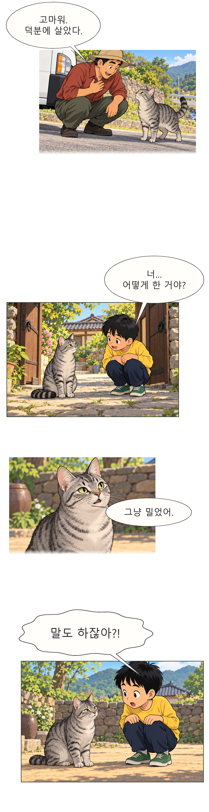

# toon_lab

원고와 컷 이미지를 세로 스크롤 웹툰으로 조립하는 로컬 제작 도구입니다. 이미지 생성 도구를 가진 AI 에이전트는 클론한 폴더에서 원고 정리부터 컷 생성, 한글 식자, 세로 PNG 조립까지 진행할 수 있습니다.

## 첫 웹툰 만들기

**준비물**은 Git, Python 3.11 이상, 이미지 생성·보기와 로컬 파일 저장·명령 실행이 가능한 AI 에이전트입니다.

### 1. 저장소 받기

```sh
git clone https://github.com/DoHyunBak/toon-lab.git
cd toon-lab
```

### 2. AI 에이전트에서 폴더 열기

방금 받은 `toon-lab` 폴더를 에이전트의 작업 폴더로 열고 아래 요청을 복사해 보세요.

```text
이 폴더의 AGENTS.md를 읽고, 네 이미지 생성 도구로 샘플 웹툰 한 컷을 만들어줘.
그림에 글자를 그리지 말고 나중에 한글로 식자해줘. 완성 PNG 경로도 알려줘.
```

내 이야기로 만들려면 원고를 채팅에 붙이거나 파일 경로를 알려주세요. 아이디어로 시작할 때는 아래 예시처럼 소재와 컷 수를 적으면 됩니다.

```text
비 오는 날, 길고양이가 우산 아래로 들어오는 짧은 이야기를 4컷 세로 웹툰으로 만들어줘.
먼저 한 컷으로 그림체를 확인한 다음, 나머지 컷을 만들고 한글 대사를 넣어줘.
```

에이전트가 Python 환경과 Pretendard를 준비하고, 원화에 한글 말풍선을 올려 조립합니다. 이미 연결된 이미지 도구를 쓰는 경우 추가 API 키와 ComfyUI 설치는 필요 없습니다.

### 3. 결과 열기

작업과 결과는 `workspace/local/` 아래에 저장됩니다. 에이전트가 알려주는 작업 폴더에서 다음 파일을 여세요.

- **`full_strip.png`** — 한 화 전체를 담은 세로 이미지
- **`slice_001.png` 등** — 나누어 저장한 세로 이미지
- **`read.html`** — 고지 포함 검토본을 만든 경우 브라우저에서 여는 미리보기

이미지 생성 도구가 없는 경우 아래 오프라인 데모로 식자와 조립을 시험할 수 있습니다. 세부 명령은 [에이전트 이미지 제작 절차](docs/public/AGENT_IMAGE_WORKFLOW.md)에 있습니다.

## 실제 제작 예시

**《임자의 모험》 1화 발췌 · toon_lab 제작팀 · AI 생성 원화와 한글 식자**

완성본에서 네 컷을 골랐습니다. 컷마다 크기와 여백을 조절하고, 인물 표정을 가리지 않도록 말풍선을 배치한 예시입니다.



[예시 PNG 원본 크기로 보기](docs/public/examples/webtoon-preview.png)

## 명령줄에서 오프라인 데모 실행

Windows PowerShell에서는 클론한 폴더에서 실행합니다.

```powershell
py -3 -m venv .venv
.\.venv\Scripts\python.exe -m pip install -r requirements.txt
.\.venv\Scripts\python.exe tools/setup_open_fonts.py
.\.venv\Scripts\python.exe -m src.demo
```

macOS와 Linux에서는 다음 명령을 실행합니다.

```sh
python3 -m venv .venv
.venv/bin/python -m pip install -r requirements.txt
.venv/bin/python tools/setup_open_fonts.py
.venv/bin/python -m src.demo
```

폰트 설치 도구는 공식 Pretendard 파일과 OFL 고지를 내려받아 해시를 확인합니다. 데모가 끝나면 `workspace/06_output_webtoon/demo/full_strip.png`를 여세요. 데모는 예제 원고와 합성 컷을 사용합니다.

Python이나 폰트가 인식되지 않으면 가상 환경의 Python으로 `-m src.factory doctor`를 실행해 어느 단계가 빠졌는지 확인하세요. [폰트 설치 안내](docs/public/FONTS.md)와 [문제 해결](docs/public/TROUBLESHOOTING.md)도 볼 수 있습니다.

## 제작 흐름

1. 원고를 장면별 텍스트 브리프로 정리하고 사용할 이미지와 입력 권한을 확인합니다.
2. 원화를 준비해 등록하고 말풍선, 효과음, 컷 사이 여백을 조정합니다.
3. 세로 PNG를 조립하고 모바일 폭에서 흐름과 가독성을 확인합니다.

[제작 절차](docs/public/PRODUCTION_RUNBOOK.md)와 [식자·편집 가이드](docs/public/EDITORIAL_LETTERING_PLAYBOOK.md)에 작업별 명령과 예제가 있습니다. 로컬 GPU 제작을 선택한 경우 [ComfyUI 설치·실행 안내](docs/public/COMFYUI_HANDOFF.md)를 따르세요.

## 참고한 프로젝트와 자료

### 코드 출처와 사용하는 도구

- **manga-studio**의 ComfyUI 그래프·HTTP 연동, 말풍선 기하, Pillow 조립 코드를 프로젝트에 맞게 수정했습니다. 원고 파서의 구조와 문법도 참고했습니다. [upstream 저장소](https://github.com/ahmet360/manga-studio) · [사용한 커밋](https://github.com/ahmet360/manga-studio/tree/2ac3cf4e3d1aaec7dd39ff44498e4e8a186733c4) · [변경 범위와 MIT 고지](THIRD_PARTY_NOTICES.md)
- **Pillow**는 이미지 처리·식자·조립에 사용합니다. **Pretendard**는 한글 식자에 쓰는 오픈 라이선스 글꼴입니다. [Pillow](https://github.com/python-pillow/Pillow) · [Pretendard](https://github.com/orioncactus/pretendard)
- **ComfyUI**는 선택형 로컬 이미지 생성 환경입니다. **TypeSafe/Jev**는 선택형 검토 연동이며, 연동 검토에 TypeSafe 공식 스킬과 문서를 참고했습니다. [ComfyUI](https://github.com/Comfy-Org/ComfyUI) · [TypeSafe 문서](https://docs.typesafe.ai/) · [TypeSafe 스킬](https://github.com/typesafe-ai/skills)

### 제작 흐름을 조사한 저장소

원고와 컷의 연결은 **manga-generator**, 실제 프롬프트 기록과 부분 실행은 **baoyu-skills**, 장면의 인과는 **community-webtoon-agent-kit**, 원화와 식자의 분리는 **agent-comic-kit**에서 참고했습니다. **mangaharness**의 비파괴 편집, **webtoon-harness**의 연속성 관리, **ARIS-Movie-Director**의 연출 의도와 결과 관찰을 구분하는 방식도 검토했습니다.

<details>
<summary>조사한 저장소 전체 보기</summary>

- **이미지 생성·캐릭터 일관성** · [HVision-NKU/StoryDiffusion](https://github.com/HVision-NKU/StoryDiffusion) · [jianzongwu/DiffSensei](https://github.com/jianzongwu/DiffSensei) · [TencentARC/PhotoMaker](https://github.com/TencentARC/PhotoMaker) · [Acly/krita-ai-diffusion](https://github.com/Acly/krita-ai-diffusion) · [lllyasviel/Fooocus](https://github.com/lllyasviel/Fooocus) · [invoke-ai/InvokeAI](https://github.com/invoke-ai/InvokeAI) · [FireRedTeam/StoryMaker](https://github.com/FireRedTeam/StoryMaker) · [Comfy-Org/ComfyUI](https://github.com/Comfy-Org/ComfyUI) · [wswszhys/ComfyUI_StoryDiffusion](https://github.com/wswszhys/ComfyUI_StoryDiffusion) · [smthemex/ComfyUI_StoryDiffusion](https://github.com/smthemex/ComfyUI_StoryDiffusion)
- **에이전트·제작 워크플로** · [revfactory/webtoon-harness](https://github.com/revfactory/webtoon-harness) · [Q0916/community-webtoon-agent-kit](https://github.com/Q0916/community-webtoon-agent-kit) · [Saeyeon-developer/agent-comic-kit](https://github.com/Saeyeon-developer/agent-comic-kit) · [BotTony329/mangaharness](https://github.com/BotTony329/mangaharness) · [jimliu/baoyu-skills](https://github.com/jimliu/baoyu-skills) · [wanshuiyin/ARIS-Movie-Director](https://github.com/wanshuiyin/ARIS-Movie-Director) · [SyMind/codex-comic](https://github.com/SyMind/codex-comic) · [bcefghj/comic-guide-skill](https://github.com/bcefghj/comic-guide-skill) · [stockedge/manga-generator](https://github.com/stockedge/manga-generator) · [RemiPelloux/agent-mangaka-forge](https://github.com/RemiPelloux/agent-mangaka-forge) · [cbthuodot/novel-comic-adapter](https://github.com/cbthuodot/novel-comic-adapter) · [Shanzoon/comic-assets-skill](https://github.com/Shanzoon/comic-assets-skill) · [lhfer/codex-novel-to-comic-studio](https://github.com/lhfer/codex-novel-to-comic-studio) · [onebluecloud/book-to-comic](https://github.com/onebluecloud/book-to-comic) · [ahmet360/manga-studio](https://github.com/ahmet360/manga-studio)
- **만화 생성·편집·분할** · [jbilcke-hf/ai-comic-factory](https://github.com/jbilcke-hf/ai-comic-factory) · [GA10d/AI-Manga-AI-Comics](https://github.com/GA10d/AI-Manga-AI-Comics) · [alexisbcz/palmframe](https://github.com/alexisbcz/palmframe) · [phaethix/inkstone](https://github.com/phaethix/inkstone) · [Aschen/comics_generator](https://github.com/Aschen/comics_generator) · [esmail-mkh/PhotoSlicer](https://github.com/esmail-mkh/PhotoSlicer) · [filiksyos/ai-comics-generator](https://github.com/filiksyos/ai-comics-generator) · [UllrAI/CineGen-ShortDrama](https://github.com/UllrAI/CineGen-ShortDrama) · [LingyiChen-AI/AIComicBuilder](https://github.com/LingyiChen-AI/AIComicBuilder) · [LlamaGenAI/webtoon](https://github.com/LlamaGenAI/webtoon) · [GL-Wen/huiman-ark](https://github.com/GL-Wen/huiman-ark) · [HBAI-Ltd/Toonflow-app](https://github.com/HBAI-Ltd/Toonflow-app) · [Anning01/novelvids](https://github.com/Anning01/novelvids) · [jays0606/mangstoon_ai](https://github.com/jays0606/mangstoon_ai) · [AmanAutomates/ManhwaGen](https://github.com/AmanAutomates/ManhwaGen) · [akiratrann/manhwa-studio](https://github.com/akiratrann/manhwa-studio)

</details>

### 연출·편집 및 연구 자료

- **기획과 장면 구성**에는 Writing Excuses, John August, Jennifer Crusie, The Open University의 창작 가이드와 웹툰 작가 인터뷰를 참고했습니다. [자료별 출처와 적용 방법](docs/public/AUTHORING_WORKFLOW.md)
- **세로 스크롤 편집과 연재 작화**에는 CELSYS 제작 안내, CLIP STUDIO PAINT 매뉴얼, 연재 작가 노트와 웹툰 연출 연구를 참고했습니다. [CELSYS 제작 안내](https://www.clipstudio.net/how-to-draw/archives/157055) · [웹툰 기능 매뉴얼](https://help.clip-studio.com/en-us/manual_en/540_comic/Webtoons.htm) · [식자·편집 가이드](docs/public/EDITORIAL_LETTERING_PLAYBOOK.md)
- **웹툰 연구와 만화 레이아웃 조사**에서 확인한 공개 서지·연구 프로젝트입니다. [WRIK](https://github.com/YunHoLeee/WRIK) · [ComiXR](https://github.com/ammarjamal/ComiXR)

## 공개 범위

공개본에는 제작 코드, 문서, 테스트, 범용 JSON 예제와 위 발췌 이미지 한 장이 들어갑니다. 소프트웨어의 MIT 라이선스는 발췌 이미지에 적용되지 않습니다. 작업 원고, 다른 컷 이미지, 제작 기록, 모델 가중치, 폰트 파일, 인증정보는 각자의 로컬 작업 공간에서 관리합니다. 이 도구는 운영자가 관리하는 로컬 환경에서 사용하세요. 파일 처리 기능과 ComfyUI API를 인터넷에 직접 노출하면 외부 사용자가 접근할 수 있습니다.

- [소스 공개 절차](docs/public/RELEASING.md)
- [보안 정책과 취약점 제보](SECURITY.md)
- [MIT 라이선스](LICENSE)와 [제3자 고지](THIRD_PARTY_NOTICES.md)
- [라이선스 적용 범위](docs/public/LICENSE_SCOPE.md)
